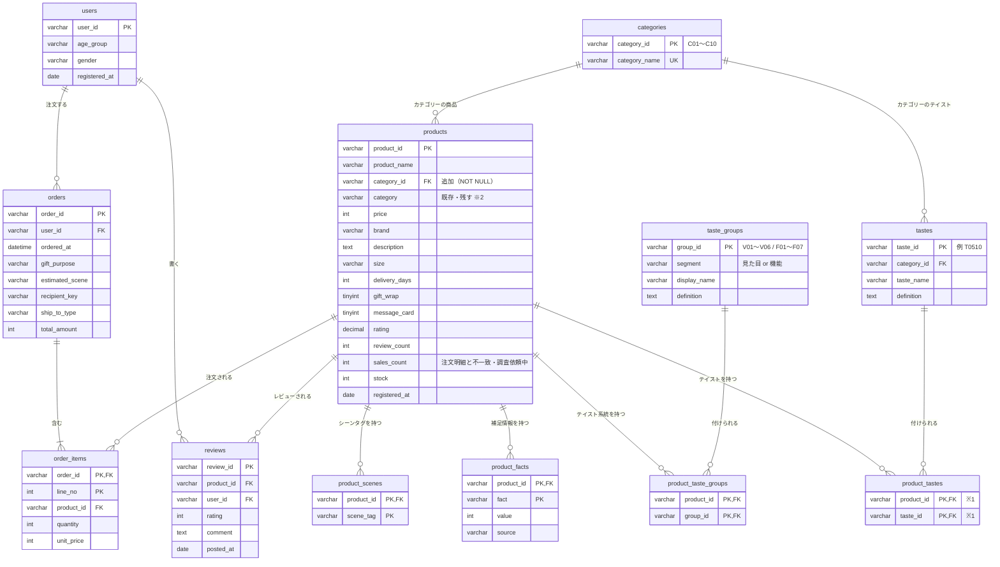

# ER 図（班の DB：giftia_t104）

テーブルの項目とつながりの正（最新版）は、このファイルです。
テーブルや項目を変えたときは、このファイルも同じ PR で直してください。

要件定義書（ver8 5.1）に貼っている画像版は [er_phase1_ver8.png](./er_phase1_ver8.png) です（中身は下の図と同じ）。

## 補足

- `product_facts` は、配布の ER 図（データ定義.md）には載っていませんが、班の DB にあるテーブルです。
- 2026-11-20：要件定義書 ver8 5.1 に合わせて、`categories`・`taste_groups`・`tastes`・`product_taste_groups`・`product_tastes` の5テーブルと、`products.category_id` を追加しました。実行した SQL は [db/](../db/README.md) にあります。
- ※1 `product_tastes`：商品とテイストは、カテゴリーが同じものだけ入れる（例：家電の商品には家電のテイストだけ）。一括投入の SQL で、合わない行は入れない。
- ※2 `products.category`：元のデータなので消さずに残す。検索・チェックには `category_id` を使う。
- テイスト系統（`taste_groups`）とテイスト（`tastes`）はひもづけない。系統はカテゴリーをまたいで探すため、テイストはカテゴリーを選んだあとに絞るために使う。
